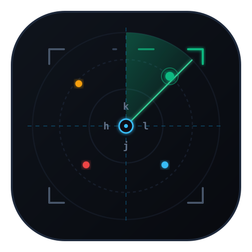
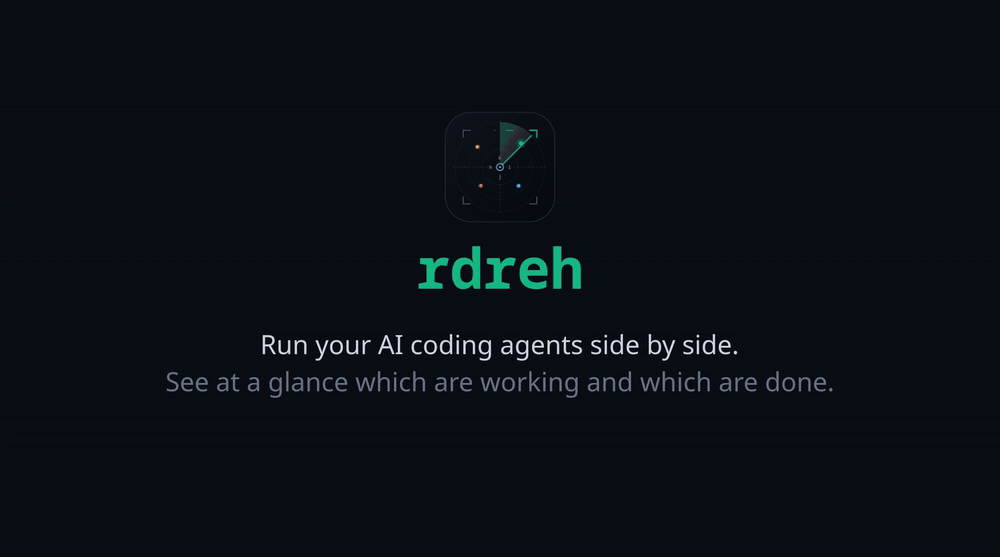

# rdreh



**rdreh** is *herdr* spelled backwards, and the opposite of a herder. The command
is `rdr`.

It is a keyboard-first terminal multiplexer for running and tracking AI coding agents
(Claude Code, OpenCode, Gemini/agy, aider, ...). It is a single Rust binary:
PTY supervisor, vt100 emulation, a ratatui UI and a Unix-socket IPC server.



rdreh began as a rewrite of `agent-swarm`, a tmux + bash setup, and is now its
own project. agent-swarm continues separately for people who prefer tmux. The
two share the agent hook (`swarm-agent-state`), but nothing else.

- **No prefix for daily moves.** Alt+0..9 workspaces, Shift+Arrows panes, Alt+l layouts, Alt+z zoom.
- **Fixed layouts.** single, dual, tri (60/40 master-stack), quad, rows, and a 5-pane cockpit. Pane geometry is recomputed on every resize, so panes never drift.
- **Agent tracking.** Hooks call `rdr state working|idle`. The status bar shows `Finished: n/m`, finished panes are flagged until you look at them, the terminal title follows the counts, and a KDE/Unity taskbar badge is sent natively over D-Bus.
- **Config-driven.** Everything lives in `~/.config/rdr/config.toml` (`rdr default-config` prints an example).

Website: https://johngf.github.io/rdreh/

## Install

```sh
cargo install rdreh           # installs the `rdr` command (or: cargo install --path .)
rdr install                   # desktop entry + icon: KRunner, app menu, taskbar
rdr completions fish > ~/.config/fish/completions/rdr.fish   # also bash, zsh, elvish, powershell
```

The binary is self-contained. `rdr install` writes the embedded `rdr.desktop`
and `rdr.svg` icon into `$XDG_DATA_HOME`, and `rdr uninstall` removes them.
If either path is an existing symlink, `install` replaces the link rather than
writing through it.

### Terminals

`rdr` typed in any terminal (kitty, Ghostty, WezTerm, foot, Alacritty, Konsole,
GNOME Terminal, ...) runs right there. When it starts without a TTY, as from
KRunner or the app menu, or when given `--term`, it opens a new window. It
picks the terminal in this order:

1. `--term`
2. `general.terminal`
3. `$TERMINAL`
4. the first installed of ghostty, kitty, wezterm, foot, alacritty, konsole,
   gnome-terminal, xdg-terminal-exec, xterm

New windows get the app id (WM class) `rdr` where the terminal supports it
(Alacritty, kitty, WezTerm, foot).

KDE Plasma's task manager identifies a window by the file name of its
executable, not its app id. Without a workaround, an rdr window started through
Alacritty is grouped under Alacritty. To prevent this, rdr runs the terminal
from a copy of its binary named `rdr`, kept in `~/.local/share/rdr/identity/`.
On btrfs/xfs the copy is a free reflink. It is refreshed automatically when the
terminal is upgraded, and skipped for script-based terminals. Set
`general.taskbar_identity = false` to launch the terminal directly instead.

After the first `rdr install`, Plasma may need a re-login, or a plasmashell
restart, before the taskbar shows the new icon.

The kitty keyboard protocol is used when the terminal supports it. Elsewhere
rdr falls back to the standard key encoding.

## Usage

```sh
rdr                 # run in this terminal (opens a terminal window when started without a TTY)
rdr --term kitty    # open in a new window of that terminal (--alacritty / --konsole shortcuts)
rdr ~/proj -l tri   # extra workspace for a project; if rdr is already running, adds it there
rdr list            # JSON state of every workspace/pane
rdr counts          # "total busy finished"
rdr state working   # from inside a pane (agent hook)
rdr layout quad | notif on | badge off | add <dir> | kill
rdr keys            # cheat sheet
```

### Token usage

```sh
rdr tokens                 # today / last 7 days / all time, per tool, largest first
rdr tokens --watch         # live dashboard, e.g. as a cockpit pane
rdr tokens --json
```

Each row shows:
- **total**
- **share** of the window
- **in:** everything the model read, including cache reads and writes
- **out:** generated tokens, including thinking/reasoning
- **hit:** the share of input served from cache

`--json` reports the same figures, plus the raw breakdown (uncached input,
cache read, cache write). The numbers come from each tool's own local records:

| Tool | Source |
| --- | --- |
| Claude Code | `~/.claude/projects/**/*.jsonl` (or `$CLAUDE_CONFIG_DIR`). Streamed duplicates are counted once. |
| OpenCode | `$XDG_DATA_HOME/opencode/opencode.db` |
| agy (Antigravity CLI) | `~/.gemini/antigravity-cli/conversations/*.db`. *Unofficial:* usage is decoded from protobuf metadata and dated by the conversation file's modification time. |
| pi | `~/.pi/agent/sessions/**/*.jsonl`. Replies copied into a forked session are counted once. |

A tool shows up once its data folder exists.

#### Adding another harness

Most agent harnesses log one JSON object per line. Describe the format in
`config.toml` and rdreh counts it, with no code change (Claude Code and pi are
built-in definitions of exactly this):

```toml
[[tokens.jsonl]]
name = "mytool"                      # row label; "claude" or "pi" replaces a built-in
dir = "~/.mytool/sessions"           # searched recursively
ext = "jsonl"                        # default
when = { type = "message", "message.role" = "assistant" }  # lines that count
id = "message.responseId"            # dedup key (a list is joined); omit to count every line
time = "timestamp"                   # RFC 3339, or Unix seconds / milliseconds
input = "message.usage.input"        # a dotted path, or a list of paths to sum
output = "message.usage.output"      # should already include reasoning
cache_read = "message.usage.cacheRead"
cache_write = "message.usage.cacheWrite"
```

A line counts when it matches `when` and has at least one of the usage fields.
Unknown keys are an error, so typos don't silently count nothing.

Only the first scan ever reads the whole history. The scanner's state is cached
in `~/.cache/rdr/tokens.json`, so every later run (and every refresh of
`--watch`) reads only new transcript bytes and changed databases: about 15 ms
instead of a second on a large history. If a transcript is deleted or replaced,
Claude usage is recounted from scratch, so totals always match a fresh scan.
Set `RDR_TOKENS_CACHE=off` to skip the cache, or to a path to move it.

### Sessions

rdreh keeps running when its window closes, like tmux.

| Action | Effect |
| --- | --- |
| `rdr` | Starts the server if needed, then attaches. If it is already running, attaches. |
| `rdr <dir>` | Adds the project to the running server, then attaches. |
| Ctrl+b d, or closing the window | Detaches. Panes, agents, scrollback and layouts keep running. |
| Ctrl+b q, or `rdr kill` | Quits. Every pane ends. The session also ends when its last pane exits. |

- Only one terminal is attached at a time. Attaching from another window takes
  over, and the first window shows "detached".
- The server runs in its own systemd user scope (`rdreh-<session>-<pid>.scope`).
  That way, closing the window, or the KRunner service that launched it, doesn't
  take it down.
- The server logs to `~/.local/state/rdr/<session>.log`.
- Running `rdr` inside an rdreh pane never nests. With folders, it adds them to
  the running server instead.

### Agent hooks

Every pane gets `RDR_PANE`, `RDR_SOCKET` and `RDR_BIN` in its environment, so a
hook only needs this:

```sh
[ -n "$RDR_SOCKET" ] && "$RDR_BIN" state working   # on prompt submit
[ -n "$RDR_SOCKET" ] && "$RDR_BIN" state idle      # on stop
```

If `RDR_PANE` is missing (for example, the agent sanitised its environment),
the server finds the pane by walking the caller's process ancestry. It gets
the caller's PID with `SO_PEERCRED`.

A pane counts as an agent when its foreground process matches
`general.agent_commands`, or when it has reported a state. Claude Code's
version-number process title (`2.1.x`) also counts. Shell panes never count.

## Keys

| Keys | Action |
| --- | --- |
| Alt+0..9 | jump to workspace |
| Shift+Arrows | move between panes; Left/Right at the edge wrap workspaces |
| Alt+\` | cycle panes |
| Alt+l | cycle layout: single, dual, tri, quad, rows, cockpit |
| Alt+z | zoom the focused pane |
| Alt+v | copy / view mode (scroll, visual select, yank to clipboard) |
| Alt+= or Alt+r | reset the layout (unzoom) |
| Alt+t / Alt+f / Alt+n | track this workspace / finish scope / notifications |
| Shift+PgUp/PgDn, mouse wheel | scrollback |
| Shift+Enter | sends Meta+Enter (newline in agent prompts) |
| Mouse drag | select and copy text to clipboard inside pane |
| Ctrl+Shift+V | terminal paste. Files copied in a file manager arrive as escaped paths on one line, not `file://` lines (Konsole, kitty, WezTerm) |
| Ctrl+b h | help overlay |
| Ctrl+b [ or v | enter copy / view mode |
| Ctrl+b p | paste the clipboard from rdr itself; copied files become escaped paths. Use it in terminals that paste nothing for copied files (Alacritty) |
| Ctrl+b d | detach (everything keeps running; `rdr` reattaches) |
| Ctrl+b c / a / n / x / & / , / q | new workspace / add project / add pane / close pane / close workspace / rename / quit |
| Ctrl+b Ctrl+b | send a literal Ctrl+b |

Inside **Copy mode** (`Alt+v` or `Ctrl+b [`):
* `hjkl` or arrows move the cursor; `Ctrl+u`/`Ctrl+d` or `PgUp`/`PgDn` jump half pages; `g`/`G` jump to top/bottom; `0`/`$` jump to start/end of line.
* `v` starts character selection; `V` starts line selection; `Space` starts selection.
* `y` or `Enter` copies selected text to system clipboard (via OSC 52 and `wl-copy`/`xclip`) and exits copy mode.
* `q` or `Esc` cancels copy mode.
* In shells, clicking and dragging with the mouse within a pane also selects and automatically copies to the clipboard upon release.

## Platforms

| Platform | Status |
| --- | --- |
| Linux, KDE Plasma | Tested daily: badge, notifications, own taskbar icon. |
| Linux, other desktops / tiling WMs / SSH | Core works anywhere. Notifications need a freedesktop notification daemon; the taskbar badge needs a dock that supports it (e.g. Ubuntu Dock). Missing pieces are skipped silently. Works without systemd. |
| macOS | Not yet supported (agent detection reads `/proc`). See [TODO.md](TODO.md). |
| Windows | Use WSL2. A native PowerShell / Windows Terminal port is planned in [TODO.md](TODO.md). |

## Testing

```sh
cargo test                 # unit + end-to-end
cargo test --test e2e      # end-to-end only (~3.5 s)
```

- **Unit tests** (`src/*`) cover layout geometry and neighbour search, key and
  mouse encoding, config parsing, the terminal-query replies, `/proc` helpers,
  and the IPC wire format.
- **End-to-end tests** (`tests/e2e.rs`) run the real binary inside a PTY. They
  type keystrokes, read the rendered screen through a vt100 parser, and query
  state with `rdr list`.
- Each test gets its own `XDG_RUNTIME_DIR` and session name, so the tests run
  in parallel and never touch a live rdr.
- A pane counts as an agent when its process name matches, so tests copy
  `sleep` to a file named `claude` to create a fake agent.

New features should come with an e2e test that uses the `Harness` helpers:
`send`, `wait_screen`, `wait_until`, `list` and `rdr_ok`.

## Design notes

- Each pane has a blocking reader thread that feeds a `vt100::Parser`, so
  hidden panes stay accurate. Redraw requests are coalesced, and frames are
  capped at about 120 fps.
- Fresh shell panes start clean (`clear_on_start`). Once startup output has
  been quiet for 300 ms, rdr sends Ctrl+L, which shells handle by clearing the
  screen and redrawing the prompt, and drops the scrollback. Nothing goes into
  shell history. The clear is skipped if you've already typed, and command
  panes are never cleared.
- rdr answers device queries that vt100 ignores: DA1/DA2, DSR cursor position,
  and OSC 10/11 colours. Without these, fish 4 and some TUIs stall at startup.
- A background server owns every pane; terminals attach to it (see
  [Sessions](#sessions)). Frames are rendered server-side at the attached
  terminal's size, and the client only forwards input and writes output.

## License

Licensed under either of

- Apache License, Version 2.0 ([LICENSE-APACHE](LICENSE-APACHE) or <https://www.apache.org/licenses/LICENSE-2.0>)
- MIT license ([LICENSE-MIT](LICENSE-MIT) or <https://opensource.org/licenses/MIT>)

at your option.

### Contribution

Unless you explicitly state otherwise, any contribution intentionally submitted
for inclusion in the work by you, as defined in the Apache-2.0 license, shall be
dual licensed as above, without any additional terms or conditions.
